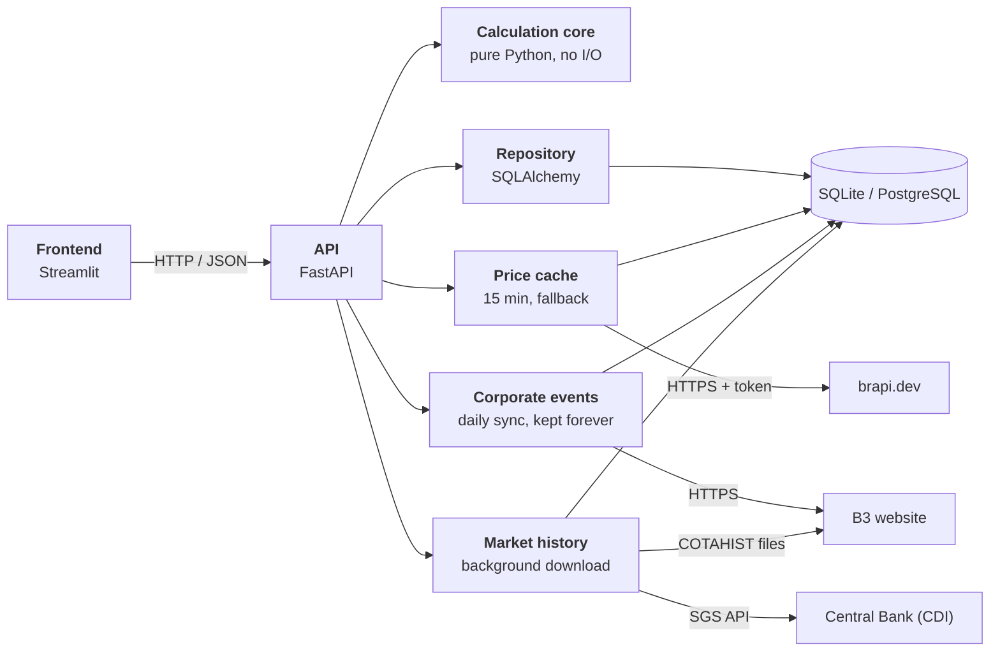

# InvestTrack

[](https://github.com/samuel-mendes-monteiro/InvestTrack/actions/workflows/ci.yml)


[](LICENSE)

> A personal investment portfolio tracker for the Brazilian stock market (B3), with live quotes and exact average-cost and profit calculations.


## The problem

People who invest through more than one broker don't get a single view of their portfolio. Each broker's app shows its own account only. Spreadsheets take effort, break easily and rarely calculate the **average cost** and **returns** correctly.

## The solution

InvestTrack is a web app where each person, with their own account, records their buy and sell trades and gets back:

- your current position in each asset
- the average cost (*preço médio*), including fees, adjusted automatically for stock splits, reverse splits and bonus shares
- realized and unrealized profit/loss, in R$ and in %
- dividends, JCP and FII distributions, **computed automatically** from what B3 publishes and what you owned on each record date, including income still to be paid
- how your portfolio is split across assets
- fixed income (CDB, LCI, LCA) at % of CDI or pre-fixed rates, valued daily with IOF and regressive income tax
- your **time-weighted return** since the first trade, compared with the CDI and the Ibovespa

Quotes from B3 are fetched automatically from [brapi.dev](https://brapi.dev), and income events from B3's own website. Invalid operations, such as selling more shares than you own on that date, are refused with a clear message:


## Core design principle

**The trade history is the single source of truth.**

Positions (quantity, average cost) are **never stored** in the database. They are always **recalculated** from the list of trades. Editing or deleting an old trade therefore updates everything automatically, and the data can never become inconsistent.

## Architecture



| Module | Responsibility |
|---|---|
| [`investtrack/portfolio.py`](investtrack/portfolio.py) | Average cost, realized and unrealized profit. Pure functions: no database, no HTTP |
| [`investtrack/income.py`](investtrack/income.py) | Income (dividends, JCP, FII distributions): computed from events and trades, monthly totals. Also pure |
| [`investtrack/events.py`](investtrack/events.py) | Stores B3 events (income, splits, bonus shares), synced once a day, with fallback to what is stored |
| [`investtrack/b3.py`](investtrack/b3.py) | The only module that knows B3's corporate events URLs and JSON format |
| [`investtrack/performance.py`](investtrack/performance.py) | Time-weighted return and benchmarks (CDI, Ibovespa). Pure |
| [`investtrack/fixed_income.py`](investtrack/fixed_income.py) | CDB, LCI and LCA: value from the CDI or a fixed rate, IOF and income tax. Pure |
| [`investtrack/market_data.py`](investtrack/market_data.py) | Stores daily prices, Ibovespa and CDI; downloads only what is missing, in the background |
| [`investtrack/history.py`](investtrack/history.py) | Clients and parsers for COTAHIST files, the Ibovespa table and the CDI series |
| [`investtrack/repository.py`](investtrack/repository.py) | Saves and reads each user's data; validates every change through the calculation core |
| [`investtrack/api.py`](investtrack/api.py) | Thin HTTP layer: converts JSON, checks the session, calls the repository, maps errors to status codes |
| [`investtrack/auth.py`](investtrack/auth.py) | Accounts, Argon2id password hashes and session tokens |
| [`investtrack/migrations/`](investtrack/migrations) | Alembic migrations, applied automatically when the API starts |
| [`investtrack/prices.py`](investtrack/prices.py) | Quote cache with fallback to the last known price |
| [`investtrack/brapi.py`](investtrack/brapi.py) | The only module that knows brapi's URL and JSON format |
| [`frontend/`](frontend) | Streamlit UI, a pure HTTP client of the API |

## Calculation rules

**Buy:** the average cost is recalculated, and fees are added to the cost.

```
new_avg = (current_qty × current_avg + bought_qty × price + fees) / (current_qty + bought_qty)
```

**Sell:** the average cost **does not change**. The difference becomes realized profit (or loss).

```
realized_profit += sold_qty × (sell_price − avg) − fees
```

Trades are processed **in date order** (not in the order they were entered), and a sale can never leave a negative quantity. Selling a whole position resets the average cost, so a later purchase starts fresh.

**Splits, reverse splits and bonus shares** (*desdobramentos*, *grupamentos*, *bonificações*) are applied at the end of their record date, after that day's trades:

```
new_qty = floor(qty × multiplier)        e.g. 1:2 split → × 2, 10:1 reverse split → × 0.1
new_avg = total_cost / (qty × multiplier)
```

- Splits and reverse splits **don't change the total cost**: 100 shares at R$ 30 become 200 at R$ 15.
- Fractions are dropped, because B3 sells them in an auction and pays the holder in cash. Their share of the cost leaves with them, so the average price is the same as without rounding. The auction cash is not tracked.
- Bonus shares enter with the **cost attributed by the company** (*custo atribuído*), which raises the total cost. B3 doesn't publish this value in its data (it is only in each company's notice to shareholders), so it is typed once per bonus event; until then the new shares count at zero cost and the UI warns about it.

**Income (*proventos*)** is computed, never typed, just like positions:

```
gross = shares held at the end of the record date (data com) × value per share
net   = gross − tax withheld   (15% on JCP; dividends and FII distributions: none)
```

- Owning the shares at the **end of the record date** gives the right, even if they are sold before the payment. A purchase on the record date itself counts.
- Income **does not change the average cost**, following Brazilian tax rules. It is tracked as a separate result.
- Announced income with a future payment date is shown as **pending** and not counted as received yet.
- Since it is recalculated from the trades, fixing an old trade fixes the income too.
- For what B3 doesn't publish (BDRs, income older than the history B3 shows), income can be entered manually, as the total shown in the broker statement.

**Fixed income** has no market price: its value comes from a formula, using the CDI already downloaded for the benchmarks.

```
% of CDI:   value = amount × Π (1 + CDI_day × percentage)      (each business day)
pre-fixed:  value = amount × (1 + annual_rate) ^ (business_days / 252)
```

- Business days come from the CDI series itself: the Central Bank publishes a rate only on business days, so it doubles as the official calendar.
- If redeemed today, a CDB pays IOF on the gain within 30 days (96% on day 1 down to 0% on day 30) and income tax on the rest of the gain: 22.5% up to 180 days, 20% up to 360, 17.5% up to 720 and 15% after that. LCI and LCA are tax exempt.
- Applying is an inflow and redeeming an outflow, so fixed income joins the portfolio's value and its TWR. An LCI at 100% of the CDI earns exactly the CDI.
- Redemptions are of the whole investment; partial redemptions and IPCA+ are not supported yet.

**Performance** is the time-weighted return (TWR), which measures how the assets did regardless of when money was put in or taken out:

```
daily_return = (value_at_close + income_paid − net_flow) / previous_value − 1
TWR          = (1 + r₁) × (1 + r₂) × … − 1
```

- Buys are inflows and sells are outflows (fees included), assumed at the end of the day: a buy's first day counts from the trade price to the close. Putting in ten times more money doesn't change the return.
- Income counts as return, net of withheld tax.
- Shares are valued at the official close of each day. A day without trades in an asset uses its last close.
- The CDI is accumulated over the same days (each day's rate is earned overnight), and the Ibovespa from the close before the first trade.

## Technical decisions

- **No `float` for money.** `Decimal` everywhere, because `0.1 + 0.2 != 0.3` in floating point. This is enforced, not just a convention: the core rejects floats, JSON numbers from brapi and from clients are parsed straight into `Decimal`, and money is typed into text fields (accepting `30,50` or `1.234,56`) because Streamlit's number input returns a float.
- **Decimals are stored as text on SQLite.** SQLite has no real decimal type, so SQLAlchemy would silently store `Numeric` as a float. A custom column type keeps exact values on SQLite and uses native `NUMERIC` on PostgreSQL.
- **Rounding happens only for display.** Calculations keep full precision; the API rounds to 2 decimals only in the response, and sends money as JSON strings (`"35.10"`) so clients never turn it into a float.
- **Calculations are isolated** in a pure module that takes a list of trades and returns positions. The repository reuses it to validate changes: adding a sale, or deleting a purchase that a later sale depends on, is refused before anything is saved.
- **Errors have stable codes.** The API returns `{"code": "INSUFFICIENT_POSITION", "ticker": ..., "available": ...}`; the frontend translates codes into Portuguese. The backend stays language-neutral.
- **Quotes are cached** in the database for 15 minutes per ticker, so the cache survives restarts and stays within brapi's free quota. If brapi is down, the last known price is shown, flagged as stale, together with when it was fetched.
- **Outages vs. per-ticker errors.** A timeout or 5xx pauses calls to brapi for a minute, so a portfolio with many tickers doesn't wait for one timeout per ticker. A 401/404 only affects that ticker.
- **The API token stays on the server**, in a `.env` file that is never committed, and is sent in a header rather than in the URL (URLs end up in logs).
- **Income events come from B3's website, not from brapi.** brapi only offers them on a paid plan. B3 has no official API either: `b3.py` uses the JSON endpoints the website itself calls. They are undocumented and may change, so everything about them is isolated in that one module, and events already stored keep working if it breaks.
- **Events are matched by ISIN, not by name.** One issuer lists events for all its securities (common and preferred shares, subscription receipts). The ISIN encodes the kind (`BRBBASACNOR3` is BBAS3, a common share), and also tells funds apart from companies, so an FII amortization (capital returned) is never counted as income.
- **Positions depend on market data, but are still never stored.** Every calculation (validating a sale, deleting a trade, the portfolio, income) uses the same `calculate_position` with the stock events, so after a 1:2 split, selling the doubled amount is accepted everywhere. Other corporate actions (spin-offs, capital reductions) need more than a factor and are not handled.
- **Events are kept forever, synced once a day.** B3 shows only about 12 months of income history (stock events go back decades). Each sync replaces the window B3 returned (so corrections apply) and keeps everything older. Events are announced days ahead, so a daily sync loses nothing and makes one request per ticker per day.
- **Only market data is stored, never what you received.** Events (value per share) are stored like quotes; your income is computed from them and your trades.
- **Historical prices come from B3's official COTAHIST files, unadjusted.** brapi's history is limited to 3 months on the free plan. Adjusted prices (like "adjusted close" elsewhere) would also be wrong here: splits and income are already applied by this project, so they would count twice.
- **The first history download runs in the background.** A year of trades needs about 100 MB (one file per month), so `/performance` answers at once with what is stored, starts the download as a FastAPI background task and returns `syncing: true`; a lock keeps two downloads from running together. After that, each day adds one 550 KB file.
- **What to download is derived, not scheduled.** The periods needed (closed months as one file, the current month day by day, until yesterday) are compared with the ones recorded as loaded. Weekdays without a file are holidays and are recorded too. Every ticker of each day is stored (about 30,000 prices a month), so a ticker added later already has its history.
- **One injectable clock.** Market data uses the same clock for "today" and for load timestamps. Mixing a fake "today" with the real clock made tests pass only on the day they were written.
- **The CDI history must reach back to the oldest investment.** Being downloaded today is not enough: registering a CDB from last year makes the CDI be fetched again from that date.
- **New tables, no migration.** Income has no quantity or price, so it isn't stored as a kind of trade. Adding tables is the safest schema change: existing databases get them on startup and no existing column changes.
- **Passwords are hashed with Argon2id**, OWASP's first recommendation: a random salt per password and a deliberately slow, memory-hungry function, so a stolen database is expensive to brute force. Lengths follow NIST (at least 8, long passphrases allowed, with an upper bound because hashing has a cost). Hashes made with weaker parameters are upgraded at the next login, the only moment the password is available.
- **Sessions are opaque tokens, not JWTs.** The client gets 256 random bits; the database keeps only their SHA-256, so reading the database doesn't give anyone a session. Logging out deletes the row, which a JWT can't do without a list of revoked tokens.
- **Login errors don't reveal accounts.** A wrong email and a wrong password give the same message, and take the same time: an unknown email is still checked against a dummy hash.
- **Every row of user data has an owner, and every query filters by it.** Another user's row by id answers 404, exactly like a missing one, so ids reveal nothing. Market data (quotes, CDI, B3 events) is shared. A test walks through every route of the API and fails if one answers without a session, so a future endpoint can't forget it.
- **The first real migration.** Until v0.4, new tables were enough (`create_all`). Adding an owner to tables that already have data needs migrations, so v0.5 brings Alembic. The baseline migration only creates missing tables, so databases from before and new ones follow the same path; the first account created adopts the data from before accounts existed. `bonus_costs` changes its primary key, which Alembic can't detect, so it is rebuilt by hand.
- **The frontend never imports the backend.** It only talks to the API over HTTP, so the Streamlit UI can later be replaced by React without touching the backend.

## Testing

```bash
pytest --cov
```

370 tests, 98% coverage. Tests never touch the internet: the HTTP session, the quote source and even the clock are replaced by fakes, so they are fast, deterministic and don't spend the API quota. Every push runs the linter, the formatter check and the tests on Python 3.12 and 3.14 with [GitHub Actions](.github/workflows/ci.yml).

The calculation tests include the worked example used to design the rules:

| Trade | Quantity | Average cost | Realized profit |
|---|---|---|---|
| Buy 100 PETR4 at R$ 30 | 100 | R$ 30.00 | R$ 0 |
| Buy 100 PETR4 at R$ 40 | 200 | R$ 35.00 | R$ 0 |
| Sell 50 PETR4 at R$ 50 | 150 | R$ 35.00 (unchanged) | R$ 750 |
| Quote at R$ 38 | 150 | R$ 35.00 | Unrealized: R$ 450 (+8.57%) |

## Getting started

Requires Python 3.12+.

```bash
git clone https://github.com/samuel-mendes-monteiro/InvestTrack.git
cd InvestTrack
python3 -m venv .venv
source .venv/bin/activate
pip install -e ".[dev,ui]"
```

Quotes come from brapi.dev. Copy the example settings and add your free brapi token (without a token, only PETR4, VALE3, MGLU3 and ITUB4 work):

```bash
cp .env.example .env
```

Optionally, create a database with a demo account, sample trades and income (it prints the email and password to log in with):

```bash
python -m investtrack.demo
```

Or create your own account on the login screen. Migrations run when the API starts; to create a new one after changing the models, use `alembic revision --autogenerate -m "..."`.

Start the API (interactive docs at http://localhost:8000/docs):

```bash
uvicorn investtrack.api:app --reload
```

In another terminal, start the web interface (http://localhost:8501):

```bash
streamlit run frontend/app.py
```

### API

Every route except `/health`, `/auth/register` and `/auth/login` needs `Authorization: Bearer <token>`, with the token returned by `/auth/login`.

| Method | Route | Description |
|---|---|---|
| `POST` | `/auth/register` | Create an account (409 if the email is taken) |
| `POST` | `/auth/login` | Get a session token, valid for 30 days |
| `POST` | `/auth/logout` | End the session |
| `GET` | `/auth/me` | The logged-in user |
| `POST` | `/operations` | Record a buy or sell (422 if selling more than owned) |
| `GET` | `/operations` | List operations, optionally filtered by `?ticker=` |
| `DELETE` | `/operations/{id}` | Delete an operation (409 if a later sale or an income depends on it) |
| `GET` | `/income` | Computed and manual income, including pending; filter by `?ticker=` and `?year=` |
| `GET` | `/income/monthly` | Net income received per month and type, optionally for one `?year=` |
| `POST` | `/income` | Record income manually (422 if the ticker wasn't bought by then) |
| `DELETE` | `/income/{id}` | Delete a manual income |
| `GET` | `/stock-events` | Splits, reverse splits and bonus shares that changed one of your positions |
| `PUT` | `/stock-events/{ticker}/{date}/unit-cost` | Attributed cost of a bonus event (404 if there is no bonus on that date) |
| `DELETE` | `/stock-events/{ticker}/{date}/unit-cost` | Back to zero cost |
| `GET` | `/portfolio` | Positions, live prices, income received and portfolio totals |
| `POST` | `/fixed-income` | Register a CDB, LCI or LCA |
| `GET` | `/fixed-income` | Each investment with gross value, IOF, income tax and net value |
| `PUT` | `/fixed-income/{id}/redemption` | Early redemption on a date (`null` undoes it) |
| `DELETE` | `/fixed-income/{id}` | Delete an investment |
| `GET` | `/performance` | Daily TWR, CDI and Ibovespa since the first trade (downloads missing history in the background) |
| `GET` | `/health` | Health check |

### Configuration

| Variable | Default | Description |
|---|---|---|
| `BRAPI_TOKEN` | *(empty)* | brapi.dev token |
| `PRICE_CACHE_MINUTES` | `15` | How long a quote is reused |
| `DATABASE_URL` | `sqlite:///investtrack.db` | Any SQLAlchemy URL, e.g. PostgreSQL |
| `API_URL` | `http://localhost:8000` | Where the frontend finds the API |

## Roadmap

- [x] Calculation core with tests
- [x] Database (SQLAlchemy)
- [x] REST API (FastAPI)
- [x] Live quotes (brapi) with caching
- [x] Streamlit UI
- [x] CI with GitHub Actions
- [x] **v0.2:** dividends, JCP and REIT (FII) income
- [x] Stock splits, reverse splits and bonus shares
- [x] Attributed cost of bonus shares (*custo atribuído*)
- [x] **v0.3:** historical performance with time-weighted return (TWR), compared with CDI and Ibovespa
- [x] **v0.4:** fixed income (CDB, LCI, LCA)
- [ ] Partial redemptions and IPCA+ fixed income
- [x] **v0.5:** login and multiple users
- [ ] **v0.6:** import B3 trade statements
- [ ] **v1.0:** React frontend and cloud deployment

## License

[MIT](LICENSE)
