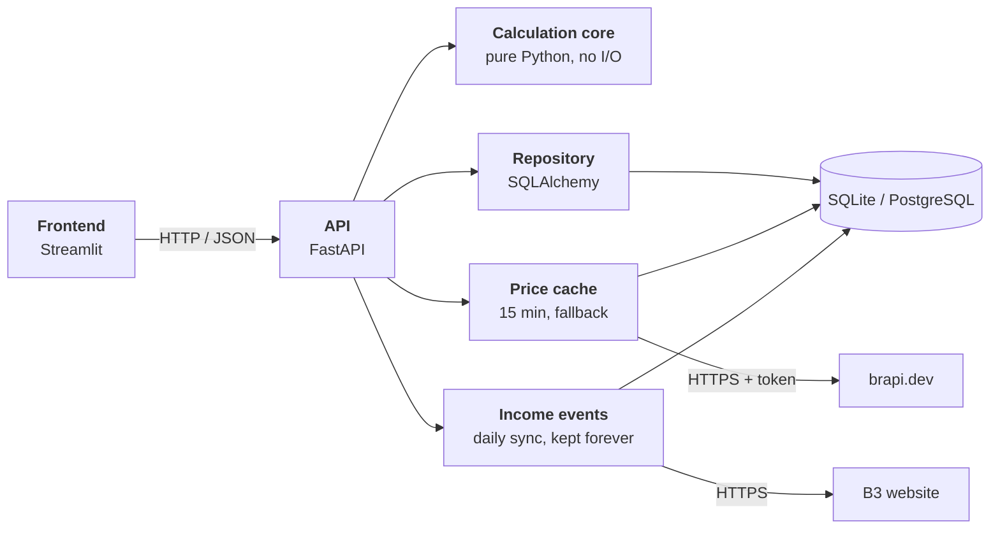

# InvestTrack

[](https://github.com/samuel-mendes-monteiro/InvestTrack/actions/workflows/ci.yml)


[](LICENSE)

> A personal investment portfolio tracker for the Brazilian stock market (B3), with live quotes and exact average-cost and profit calculations.


## The problem

People who invest through more than one broker don't get a single view of their portfolio. Each broker's app shows its own account only. Spreadsheets take effort, break easily and rarely calculate the **average cost** and **returns** correctly.

## The solution

InvestTrack is a web app where you record your buy and sell trades and get back:

- your current position in each asset
- the average cost (*preço médio*), including fees
- realized and unrealized profit/loss, in R$ and in %
- dividends, JCP and FII distributions, **computed automatically** from what B3 publishes and what you owned on each record date, including income still to be paid
- how your portfolio is split across assets

Quotes from B3 are fetched automatically from [brapi.dev](https://brapi.dev), and income events from B3's own website. Invalid operations, such as selling more shares than you own on that date, are refused with a clear message:


## Core design principle

**The trade history is the single source of truth.**

Positions (quantity, average cost) are **never stored** in the database. They are always **recalculated** from the list of trades. Editing or deleting an old trade therefore updates everything automatically, and the data can never become inconsistent.

## Architecture



| Module | Responsibility |
|---|---|
| [`investtrack/portfolio.py`](investtrack/portfolio.py) | Average cost, realized and unrealized profit. Pure functions: no database, no HTTP |
| [`investtrack/income.py`](investtrack/income.py) | Income (dividends, JCP, FII distributions): computed from events and trades, monthly totals. Also pure |
| [`investtrack/income_events.py`](investtrack/income_events.py) | Stores B3 income events, synced once a day, with fallback to what is stored |
| [`investtrack/b3.py`](investtrack/b3.py) | The only module that knows B3's URLs and JSON format |
| [`investtrack/repository.py`](investtrack/repository.py) | Saves and reads trades; validates every change through the calculation core |
| [`investtrack/api.py`](investtrack/api.py) | Thin HTTP layer: converts JSON, calls the repository, maps errors to status codes |
| [`investtrack/prices.py`](investtrack/prices.py) | Quote cache with fallback to the last known price |
| [`investtrack/brapi.py`](investtrack/brapi.py) | The only module that knows brapi's URL and JSON format |
| [`frontend/`](frontend) | Streamlit UI, a pure HTTP client of the API |

## Calculation rules

**Buy:** the average cost is recalculated, and fees are added to the cost.

```
new_avg = (current_qty × current_avg + bought_qty × price + fees) / (current_qty + bought_qty)
```

**Sell:** the average cost **does not change**. The difference becomes realized profit (or loss).

```
realized_profit += sold_qty × (sell_price − avg) − fees
```

Trades are processed **in date order** (not in the order they were entered), and a sale can never leave a negative quantity. Selling a whole position resets the average cost, so a later purchase starts fresh.

**Income (*proventos*)** is computed, never typed, just like positions:

```
gross = shares held at the end of the record date (data com) × value per share
net   = gross − tax withheld   (15% on JCP; dividends and FII distributions: none)
```

- Owning the shares at the **end of the record date** gives the right, even if they are sold before the payment. A purchase on the record date itself counts.
- Income **does not change the average cost**, following Brazilian tax rules. It is tracked as a separate result.
- Announced income with a future payment date is shown as **pending** and not counted as received yet.
- Since it is recalculated from the trades, fixing an old trade fixes the income too.
- For what B3 doesn't publish (BDRs, income older than the history B3 shows), income can be entered manually, as the total shown in the broker statement.

## Technical decisions

- **No `float` for money.** `Decimal` everywhere, because `0.1 + 0.2 != 0.3` in floating point. This is enforced, not just a convention: the core rejects floats, JSON numbers from brapi and from clients are parsed straight into `Decimal`, and money is typed into text fields (accepting `30,50` or `1.234,56`) because Streamlit's number input returns a float.
- **Decimals are stored as text on SQLite.** SQLite has no real decimal type, so SQLAlchemy would silently store `Numeric` as a float. A custom column type keeps exact values on SQLite and uses native `NUMERIC` on PostgreSQL.
- **Rounding happens only for display.** Calculations keep full precision; the API rounds to 2 decimals only in the response, and sends money as JSON strings (`"35.10"`) so clients never turn it into a float.
- **Calculations are isolated** in a pure module that takes a list of trades and returns positions. The repository reuses it to validate changes: adding a sale, or deleting a purchase that a later sale depends on, is refused before anything is saved.
- **Errors have stable codes.** The API returns `{"code": "INSUFFICIENT_POSITION", "ticker": ..., "available": ...}`; the frontend translates codes into Portuguese. The backend stays language-neutral.
- **Quotes are cached** in the database for 15 minutes per ticker, so the cache survives restarts and stays within brapi's free quota. If brapi is down, the last known price is shown, flagged as stale, together with when it was fetched.
- **Outages vs. per-ticker errors.** A timeout or 5xx pauses calls to brapi for a minute, so a portfolio with many tickers doesn't wait for one timeout per ticker. A 401/404 only affects that ticker.
- **The API token stays on the server**, in a `.env` file that is never committed, and is sent in a header rather than in the URL (URLs end up in logs).
- **Income events come from B3's website, not from brapi.** brapi only offers them on a paid plan. B3 has no official API either: `b3.py` uses the JSON endpoints the website itself calls. They are undocumented and may change, so everything about them is isolated in that one module, and events already stored keep working if it breaks.
- **Events are matched by ISIN, not by name.** One issuer lists events for all its securities (common and preferred shares, subscription receipts). The ISIN encodes the kind (`BRBBASACNOR3` is BBAS3, a common share), and also tells funds apart from companies, so an FII amortization (capital returned) is never counted as income.
- **Events are kept forever, synced once a day.** B3 shows only about 12 months of history. Each sync replaces the window B3 returned (so corrections apply) and keeps everything older. Events are announced days ahead, so a daily sync loses nothing and makes one request per ticker per day.
- **Only market data is stored, never what you received.** Events (value per share) are stored like quotes; your income is computed from them and your trades.
- **New tables, no migration.** Income has no quantity or price, so it isn't stored as a kind of trade. Adding tables is the safest schema change: existing databases get them on startup and no existing column changes.
- **The frontend never imports the backend.** It only talks to the API over HTTP, so the Streamlit UI can later be replaced by React without touching the backend.

## Testing

```bash
pytest --cov
```

197 tests, 98% coverage. Tests never touch the internet: the HTTP session, the quote source and even the clock are replaced by fakes, so they are fast, deterministic and don't spend the API quota. Every push runs the linter, the formatter check and the tests on Python 3.12 and 3.14 with [GitHub Actions](.github/workflows/ci.yml).

The calculation tests include the worked example used to design the rules:

| Trade | Quantity | Average cost | Realized profit |
|---|---|---|---|
| Buy 100 PETR4 at R$ 30 | 100 | R$ 30.00 | R$ 0 |
| Buy 100 PETR4 at R$ 40 | 200 | R$ 35.00 | R$ 0 |
| Sell 50 PETR4 at R$ 50 | 150 | R$ 35.00 (unchanged) | R$ 750 |
| Quote at R$ 38 | 150 | R$ 35.00 | Unrealized: R$ 450 (+8.57%) |

## Getting started

Requires Python 3.12+.

```bash
git clone https://github.com/samuel-mendes-monteiro/InvestTrack.git
cd InvestTrack
python3 -m venv .venv
source .venv/bin/activate
pip install -e ".[dev,ui]"
```

Quotes come from brapi.dev. Copy the example settings and add your free brapi token (without a token, only PETR4, VALE3, MGLU3 and ITUB4 work):

```bash
cp .env.example .env
```

Optionally, create a database with sample trades and income:

```bash
python -m investtrack.demo
```

Start the API (interactive docs at http://localhost:8000/docs):

```bash
uvicorn investtrack.api:app --reload
```

In another terminal, start the web interface (http://localhost:8501):

```bash
streamlit run frontend/app.py
```

### API

| Method | Route | Description |
|---|---|---|
| `POST` | `/operations` | Record a buy or sell (422 if selling more than owned) |
| `GET` | `/operations` | List operations, optionally filtered by `?ticker=` |
| `DELETE` | `/operations/{id}` | Delete an operation (409 if a later sale or an income depends on it) |
| `GET` | `/income` | Computed and manual income, including pending; filter by `?ticker=` and `?year=` |
| `GET` | `/income/monthly` | Net income received per month and type, optionally for one `?year=` |
| `POST` | `/income` | Record income manually (422 if the ticker wasn't bought by then) |
| `DELETE` | `/income/{id}` | Delete a manual income |
| `GET` | `/portfolio` | Positions, live prices, income received and portfolio totals |
| `GET` | `/health` | Health check |

### Configuration

| Variable | Default | Description |
|---|---|---|
| `BRAPI_TOKEN` | *(empty)* | brapi.dev token |
| `PRICE_CACHE_MINUTES` | `15` | How long a quote is reused |
| `DATABASE_URL` | `sqlite:///investtrack.db` | Any SQLAlchemy URL, e.g. PostgreSQL |
| `API_URL` | `http://localhost:8000` | Where the frontend finds the API |

## Roadmap

- [x] Calculation core with tests
- [x] Database (SQLAlchemy)
- [x] REST API (FastAPI)
- [x] Live quotes (brapi) with caching
- [x] Streamlit UI
- [x] CI with GitHub Actions
- [x] **v0.2:** dividends, JCP and REIT (FII) income
- [ ] Adjust income for stock splits and bonus shares (*desdobramentos*, *bonificações*)
- [ ] **v0.3:** historical performance with time-weighted return (TWR), compared with CDI and Ibovespa
- [ ] **v0.4:** fixed income (CDB, LCI, LCA)
- [ ] **v0.5:** login and multiple users
- [ ] **v0.6:** import B3 trade statements
- [ ] **v1.0:** React frontend and cloud deployment

## License

[MIT](LICENSE)
